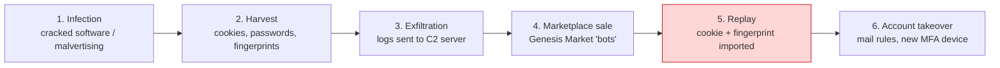
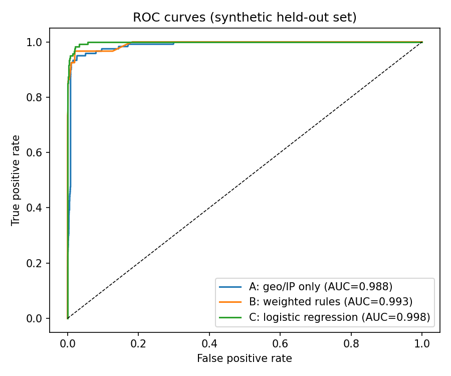
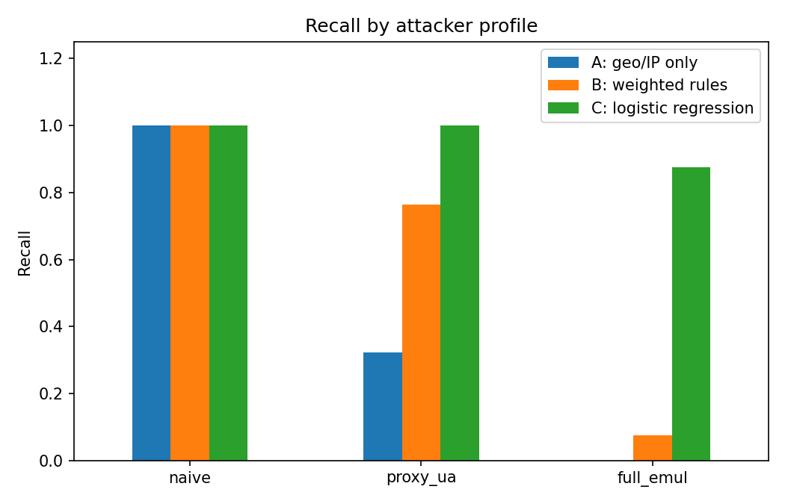
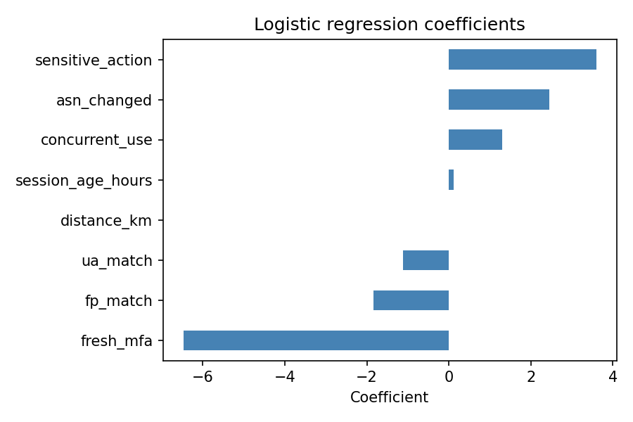

<div align="center">

# 🛡️ Infostealer-Driven Session Hijacking & MFA Bypass Detection

### A Digital Forensics Case Study of the Genesis Market Takedown (Operation Cookie Monster, 2023)


**Group 36 · Cyber Security · Theory CA-2 (Part 2)**
Symbiosis Institute of Technology, Pune · B.Tech CSE · AY 2026

</div>

---

## 📑 Table of Contents
1. [Team](#-team)
2. [Overview](#-overview)
3. [Attack Chain](#-attack-chain)
4. [Features Used](#-features-used)
5. [Detectors Compared](#-detectors-compared)
6. [Project Structure](#-project-structure)
7. [How to Execute](#-how-to-execute)
8. [Results](#-results)
9. [Key Findings](#-key-findings)
10. [Ethics & Limitations](#-ethics--limitations)
11. [Troubleshooting](#-troubleshooting)
12. [References](#-references)

---

## 👥 Team

| Name | PRN | 
|---|---|
| Utsav Raj Singh | 23070122256 |
| Sourav Singh | 23070122257 |
| Sumit Pathak | 23070122255 |

**Guide:** Dr. Pooja Bagane, Professor, Dept. of Computer Science & Engineering

**🔗 GitHub Repository:** https://github.com/YOUR-USERNAME/YOUR-REPO-NAME

---

## 🔍 Overview

Multi-factor authentication (MFA) protects the **login event**, not the **session** that follows.
Infostealer malware copies a victim's session cookies and browser profile; an attacker then
**replays** that session from another machine and inherits the already-completed MFA check.

**Genesis Market** (active ~2018, dismantled April 2023 in *Operation Cookie Monster*) sold
exactly these per-victim packages: credentials + cookies + browser fingerprints.

This repository contains the **detection experiment** from our report. Because real marketplace
evidence is not public, we generate a **synthetic dataset of 20,400 sessions**
(20,000 legitimate + 400 replayed-cookie sessions, 2% base rate) and compare three detectors.

---

## ⛓️ Attack Chain



MITRE ATT&CK mapping: **T1539** (Steal Web Session Cookie), **T1555.003** (Credentials from Web Browsers),
**T1550.004** (Use Alternate Authentication Material: Web Session Cookie), **T1185** (Browser Session Hijacking).

---

## 🧮 Features Used

Eight features are computed per session:

| # | Feature | Why it matters |
|---|---|---|
| 1 | `asn_changed` | Replay usually comes from a different network |
| 2 | `distance_km` | Large jumps = different location (small ones can be proxied) |
| 3 | `ua_match` | Copied / mismatched user-agent reveals tooling |
| 4 | `fp_match` | Canvas, fonts, screen, timezone should stay stable |
| 5 | `concurrent_use` | Victim and attacker active on one session |
| 6 | `session_age_hours` | Stolen sessions are replayed hours to days later |
| 7 | `sensitive_action` | Mail-forwarding rule, new MFA device, payout change |
| 8 | `fresh_mfa` | A replayed session never completed MFA itself |

**Attacker profiles simulated:** `naive` (no attempt to match victim) ·
`proxy_ua` (regional proxy + copied user agent) · `full_emul` (location, UA and fingerprint matched).

---

## 🤖 Detectors Compared

| Detector | Type | Logic |
|---|---|---|
| **A** | Geo/IP rule | Flag if distance > 500 km (legacy impossible-travel) |
| **B** | Weighted rules | Hand-weighted score over all 8 signals, flag if score ≥ 6 |
| **C** | Logistic regression | Class-weighted model, trained on stratified 70% split |

Evaluation is done on the held-out **30% split = 6,120 sessions (120 attacks)**.

---

## 📁 Project Structure

```
G36_Session_Hijack_Detection/
├── README.md                  ← you are here
├── requirements.txt           ← Python dependencies
├── run.bat                    ← Windows: install + run in one click
├── build_exe.bat              ← Windows: build standalone .exe
├── exe/
│   └── G36_Detection.exe      ← standalone executable (no Python needed)
├── .github/workflows/
│   └── build-exe.yml          ← GitHub Actions: auto-builds the Windows exe
├── src/
│   ├── generate_dataset.py    ← synthetic session generator
│   ├── detectors.py           ← Detectors A, B, C
│   └── evaluate.py            ← main entry point (full pipeline)
├── data/
│   └── synthetic_sessions.csv ← generated dataset (20,400 rows)
├── results/                   ← metrics (.csv), figures (.png), console output
└── report/
    └── G_36_Report.docx       ← full case-study report
```

---

## ▶️ How to Execute

**Requirements:** Python 3.10 or newer, internet only for the first `pip install`.

### Option 1: Run the Python source
```bash
# 1. Clone the repository
git clone https://github.com/YOUR-USERNAME/YOUR-REPO-NAME.git
cd YOUR-REPO-NAME

# 2. (Optional) create a virtual environment
python -m venv venv
venv\Scripts\activate            # Windows
# source venv/bin/activate       # Linux / macOS

# 3. Install dependencies
pip install -r requirements.txt

# 4. Run the full experiment
python src/evaluate.py
```

### Option 2: Windows one-click
Double-click **`run.bat`**.

### Option 3: Standalone `.exe` (no Python needed)
Run **`exe\G36_Detection.exe`** (included in the submission zip). Double-click it; it runs the same
pipeline and creates `data\` and `results\` folders **next to the exe**. The window stays open until you press Enter.

Rebuild the exe yourself if needed:
- **Windows:** double-click `build_exe.bat` → `dist\G36_Detection.exe`
- **GitHub Actions (automatic):** every push to `main` builds it on a Windows server; download it from
  **Actions → Build Windows EXE → latest run → Artifacts → `G36_Detection_exe`**

### Generate only the dataset
```bash
python src/generate_dataset.py
```

> The program prints all metrics in the terminal and saves tables and figures to the `results/` folder.
> Results are **fully reproducible** (random seed = 42).

---

## 📊 Results

### Overall performance (held-out set: 6,120 sessions, 120 attacks)

| Detector | Precision | Recall | F1 | FPR | AUC | TP | FP | FN |
|---|---|---|---|---|---|---|---|---|
| A: geo/IP only | 0.528 | 0.475 | 0.500 | 0.85% | 0.988 | 57 | 51 | 63 |
| B: weighted rules | **1.000** | 0.625 | **0.769** | **0.00%** | 0.993 | 75 | 0 | 45 |
| C: logistic regression | 0.520 | **0.958** | 0.674 | 1.77% | **0.998** | 115 | 106 | 5 |

### Recall by attacker profile

| Detector | naive | proxy + UA | full emulation |
|---|---|---|---|
| A: geo/IP only | 1.00 | 0.32 | 0.00 |
| B: weighted rules | 1.00 | 0.76 | 0.08 |
| C: logistic regression | 1.00 | 1.00 | **0.88** |

### Figures

<p align="center">
  
  
</p>
<p align="center">
  
</p>

Full output: [`results/console_output.txt`](results/console_output.txt)

---

## 💡 Key Findings

1. **Geo/IP-only detection is fragile.** Recall drops from 1.00 (naive) to 0.00 (full emulation) once the
   attacker uses a country-matched proxy and copied browser details.
2. **Signal fusion helps, but hand-tuned rules are not enough.** Detector B is extremely precise but
   misses most fully emulated attackers (recall 0.08).
3. **The `fresh_mfa` feature dominates.** It has the largest coefficient in the logistic regression
   (≈ −6.5): a replayed session never performed its own MFA, so session *lineage* survives even
   when network and browser attributes are perfectly copied.
4. **MFA alone is not enough.** Defences must include session-bound credentials (device-bound sessions,
   DPoP), short token lifetimes, endpoint hygiene (EDR, app-bound cookie encryption) and cross-signal
   session monitoring.
5. **Takedowns help but do not solve the problem.** Stealer logs keep appearing as long as infostealers exist.

---

## ⚖️ Ethics & Limitations

- **No real data used.** No real credentials, malware samples, marketplace content or victim data.
  The code only simulates *detection*; it contains **no attack or stealer tooling**.
- All attacker probabilities are **assumptions of the study**, not measurements of real attacks.
- Legitimate sessions have a fresh MFA event 97% of the time here. In real systems with
  "remember this device" and long-lived refresh tokens, separation will be smaller.
- Results show the **relative value of signals**, not production accuracy.

---

## 🛠️ Troubleshooting

| Problem | Fix |
|---|---|
| `python` not recognised | Install Python from python.org and tick **Add to PATH** |
| `ModuleNotFoundError` | Run `pip install -r requirements.txt` |
| Plots not saved | Make sure the `results/` folder is writable |
| `.exe` flagged by antivirus | PyInstaller false positive; run from source instead |
| Different numbers than report | Check seed is 42 and scikit-learn version is 1.8.0 |

---

## 📚 References

Key sources (full list in the report):
- DOJ and Europol press releases on Operation Cookie Monster (Apr 2023)
- MITRE ATT&CK: T1539, T1550.004, T1555.003, T1185
- NIST SP 800-86 (Forensic techniques) and NIST SP 800-63B (Authentication & session management)
- Thomas et al., *Data Breaches, Phishing, or Malware?*, CCS 2017
- Pedregosa et al., *Scikit-learn: Machine Learning in Python*, JMLR 2011

---

<div align="center">
Made by <b>Group 36</b> · Symbiosis Institute of Technology, Pune · 2026
</div>
